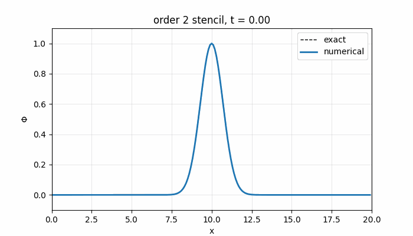
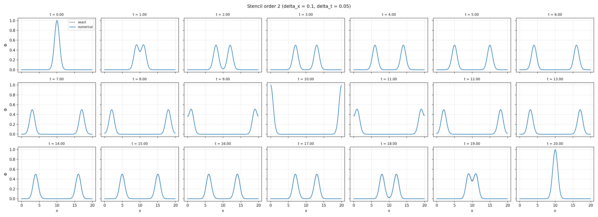
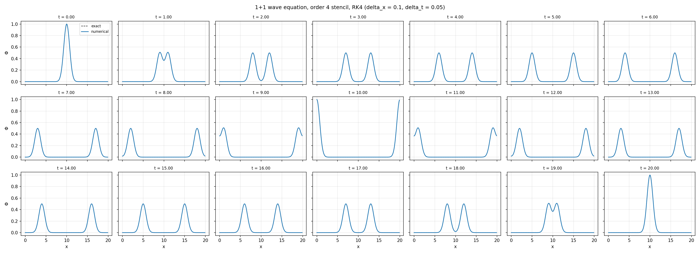
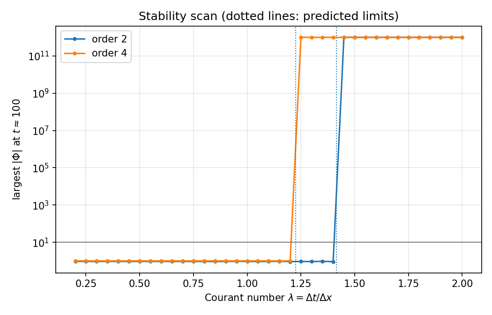
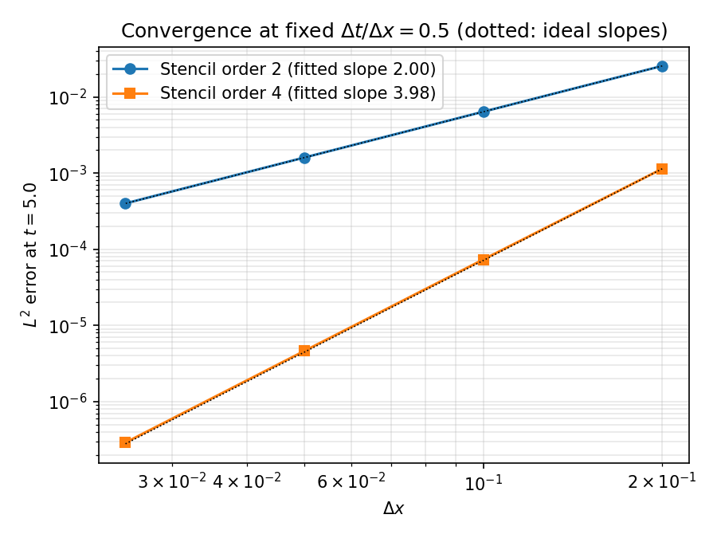

# Wave equation evolution in 1+1 dimensions

This repository contains a solver for the scalar wave equation in one spatial dimension, written as an introductory assignment for the Witek Gravity Group.



The animation above shows the evolution of the initial Gaussian pulse up to $t = 20$ with the second-order stencil. 

## Method

The scalar field $\Phi(t, x)$ satisfies $\Box \Phi = 0$. In 1+1 dimensions, with the Minkowski metric $\eta = \mathrm{diag}(-1, 1)$, this reads

$$-\partial_t^2 \Phi + \partial_x^2 \Phi = 0.$$

Introducing the momentum $\Pi = -\partial_t \Phi$ reduces the equation to a first-order system in time,

$$\partial_t \Phi = -\Pi, \qquad \partial_t \Pi = -\partial_x^2 \Phi,$$

which is evolved using the method of lines. The domain is $x \in [0, 20)$ with periodic boundary conditions, discretised on a uniform grid of $N = L / \Delta x$ points, where $L = 20$. We use both the second and fourth-order stencil. The second-order stencil is

$$\partial_x^2 \Phi_i \approx \frac{\Phi_{i+1} - 2 \Phi_i + \Phi_{i-1}}{\Delta x^2},$$

and the fourth-order stencil is

$$\partial_x^2 \Phi_i \approx \frac{-\Phi_{i+2} + 16 \Phi_{i+1} - 30 \Phi_i + 16 \Phi_{i-1} - \Phi_{i-2}}{12 \, \Delta x^2}.$$

We use RK4 to numerically integrate.

The initial data are a Gaussian centred in the domain with zero initial velocity,

$$\Phi(0, x) = e^{-(x - 10)^2}, \qquad \partial_t \Phi(0, x) = 0,$$

which splits into two pulses of half the amplitude travelling in opposite directions. On a periodic domain the exact solution follows from d'Alembert's formula, 

$$\Phi(t, x) = \frac{1}{2} \sum_{k} \left[ f(x - t + kL) + f(x + t + kL) \right], \qquad f(s) = e^{-(s - 10)^2},$$

and this is used as the reference for all error measurements. The error is quantified with the discrete $L^2$ norm, $\lVert u \rVert_2 = \sqrt{\Delta x \sum_i u_i^2}$, and the relative error is $\lVert \Phi - \Phi_{\mathrm{exact}} \rVert_2 / \lVert \Phi_{\mathrm{exact}} \rVert_2$.

## Repository layout

```
numrel-wave-evolution/
├── CMakeLists.txt
├── include/       grid, solver and stencil headers
├── src/           C++ implementation and the command-line driver
├── scripts/       Python analysis and plotting scripts
├── figures/       generated figures and the animation
├── data/          solver output (not tracked)
└── report/        the full write-up
```

## Building and running

The solver requires CMake 3.15 or later and a compiler with C++20 support. The Python scripts require NumPy, Matplotlib and Pillow. 

```
cmake -S . -B build
cmake --build build
```

The executable takes six arguments: the grid spacing, the time step, the stencil order (2 or 4), the final time, the interval between saved snapshots, and the output path.

```
./build/wave_solver 0.1 0.05 2 20 0.05 data/run.csv
```

## Results

### Evolution

The figures below show $\Phi(x)$ at integer times from $t = 0$ to $t = 20$ for $\Delta x = 0.1$ and $\Delta t = 0.05$. The initial pulse separates into two pulses that cross the periodic boundary and recombine at $x = 0$ when $t = 10$. They then travel back and form the original pulse again at $x = 10$ when $t = 20$.

**Second-order stencil**



**Fourth-order stencil**



### Stability

Because the time integration is explicit, the ratio $\lambda = \Delta t / \Delta x$ is bounded above for stability. The scan below evolves the system to $t = 100$ at $\Delta x = 0.1$ for $\lambda$ between 0.20 and 2.00 in steps of 0.05. A run is counted as unstable when $\lvert \Phi \rvert$ exceeds 10.




| Stencil | Largest stable $\lambda$ tested | Smallest unstable $\lambda$ tested | Predicted limit |
|---------|-------------------------------:|-----------------------------------:|----------------:|
| Second order | 1.40 | 1.45 | $\sqrt{2} \approx 1.414$ |
| Fourth order | 1.20 | 1.25 | $\sqrt{3/2} \approx 1.225$ |


### Convergence

The convergence study uses $\lambda = 0.5$ and halves $\Delta x$ from 0.2 down to 0.025. The $L^2$ error against the exact solution at $t = 5$ falls with fitted slopes of 2.00 for the second-order stencil and 3.98 for the fourth-order stencil.



The errors behind the figure are tabulated below. 

**Second-order stencil** (fitted slope 2.00 at $t = 5$)

| $\Delta x$ | $L^2$ error | Relative error | Local order |
|-----------:|------------:|---------------:|------------:|
| 0.2   | $2.549 \times 10^{-2}$ | $3.220 \times 10^{-2}$ | |
| 0.1   | $6.386 \times 10^{-3}$ | $8.067 \times 10^{-3}$ | 2.00 |
| 0.05  | $1.597 \times 10^{-3}$ | $2.017 \times 10^{-3}$ | 2.00 |
| 0.025 | $3.992 \times 10^{-4}$ | $5.043 \times 10^{-4}$ | 2.00 |

**Fourth-order stencil** (fitted slope 3.98 at $t = 5$)

| $\Delta x$ | $L^2$ error | Relative error | Local order |
|-----------:|------------:|---------------:|------------:|
| 0.2   | $1.138 \times 10^{-3}$ | $1.437 \times 10^{-3}$ | |
| 0.1   | $7.322 \times 10^{-5}$ | $9.249 \times 10^{-5}$ | 3.96 |
| 0.05  | $4.610 \times 10^{-6}$ | $5.823 \times 10^{-6}$ | 3.99 |
| 0.025 | $2.886 \times 10^{-7}$ | $3.646 \times 10^{-7}$ | 4.00 |

The slopes are measured at $t = 5$ and not at $t = 20$, because the exact solution returns to its initial state after one full period. For each Fourier mode the phase error of the scheme then enters the error only at second order, so that the fitted slopes at $t = 20$ are 3.90 and 5.60 and do not reflect the orders of the stencils.

The errors at the end of the full-period run, $t = 20$, are tabulated below for the same four grid spacings. The row with $\Delta x = 0.1$ corresponds to the assignment run itself, with $\Delta t = 0.05$, so the relative errors in that row are the headline accuracy of the evolution shown in the snapshots and the animation. The local order is the slope between consecutive rows, and it is inflated for the reason given above.

**Second-order stencil** (fitted slope 3.90 at $t = 20$)

| $\Delta x$ | $L^2$ error | Relative error | Local order |
|-----------:|------------:|---------------:|------------:|
| 0.2   | $5.055 \times 10^{-2}$ | $4.516 \times 10^{-2}$ | |
| 0.1   | $3.894 \times 10^{-3}$ | $3.478 \times 10^{-3}$ | 3.70 |
| 0.05  | $2.476 \times 10^{-4}$ | $2.211 \times 10^{-4}$ | 3.98 |
| 0.025 | $1.549 \times 10^{-5}$ | $1.383 \times 10^{-5}$ | 4.00 |

**Fourth-order stencil** (fitted slope 5.60 at $t = 20$)

| $\Delta x$ | $L^2$ error | Relative error | Local order |
|-----------:|------------:|---------------:|------------:|
| 0.2   | $5.829 \times 10^{-4}$ | $5.206 \times 10^{-4}$ | |
| 0.1   | $6.644 \times 10^{-6}$ | $5.935 \times 10^{-6}$ | 6.45 |
| 0.05  | $1.611 \times 10^{-7}$ | $1.439 \times 10^{-7}$ | 5.37 |
| 0.025 | $4.862 \times 10^{-9}$ | $4.343 \times 10^{-9}$ | 5.05 |

At $\Delta x = 0, \Delta t = 0.05$ the second-order stencil reproduces the exact solution to a relative error of about $3.5 \times 10^{-3}$, and the fourth-order stencil does so to about $5.9 \times 10^{-6}$, an improvement by a factor of about 600.

## Further details

A more detailed analysis can be found in `writeup.pdf`.
